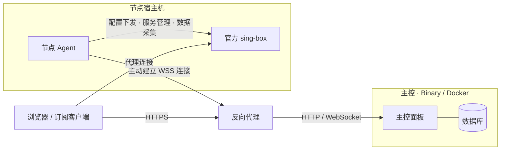

<h1 align="center">
  <picture>
    <source media="(prefers-color-scheme: dark)" srcset="docs/assets/readme-header-dark.svg">
    
  </picture>
</h1>

<p align="center">面向官方 sing-box 的多节点管理面板，统一管理配置、用户、订阅与流量。</p>

<p align="center">
  <a href="https://github.com/hann0w0/SingBox-Panel/releases"></a>
  
  
  
  <a href="#安装"></a>
</p>

<p align="center">
  <a href="#安装">安装</a> ·
  <a href="#卸载">卸载</a> ·
  <a href="#工作模式">工作模式</a> ·
  <a href="docs/docker.md">Docker 部署说明</a> ·
  <a href="#开源许可">开源许可</a>
</p>

## 安装

主控支持 Linux `amd64` / `arm64`，需配合域名与 HTTPS 反向代理访问（支持 WebSocket 并覆盖 `X-Real-IP`）。

### Binary

适用于 `systemd` 主机。执行安装脚本并按提示完成配置：

```bash
curl -fsSL https://github.com/hann0w0/SingBox-Panel/releases/latest/download/install.sh | sudo bash
```

默认监听 `127.0.0.1:32334`，数据保存在 `/opt/singbox-panel`。

### Docker

替换域名、管理员账号和初始密码后执行：

```bash
docker run -d \
  --name singbox-panel \
  --restart unless-stopped \
  --stop-timeout 30 \
  -p 127.0.0.1:32334:8080 \
  -v singbox-panel-data:/app/data \
  -e SINGBOX_PANEL_BASE_URL='https://panel.example.com' \
  -e SINGBOX_PANEL_ADMIN_EMAIL='admin' \
  -e SINGBOX_PANEL_ADMIN_PASSWORD='请替换为自己的初始密码' \
  ghcr.io/hann0w0/singbox-panel:latest
```

Compose 配置、反向代理示例与更新步骤见 [Docker 部署说明](docs/docker.md)。

### 接入节点

Binary 与 Docker 主控均按以下步骤接入节点（支持 `systemd` 与 Alpine `OpenRC`）：

1. 在面板中创建服务器。
2. 复制服务器详情页生成的 Agent 安装命令。
3. 在目标 VPS 执行该命令。

## 卸载

卸载主控不会卸载节点上的 Agent 和 `sing-box`。

### Binary 主控

卸载服务，保留配置与数据库：

```bash
curl -fsSL https://github.com/hann0w0/SingBox-Panel/releases/latest/download/install.sh | sudo bash -s -- --uninstall --yes
```

完整卸载，删除配置与数据库：

```bash
curl -fsSL https://github.com/hann0w0/SingBox-Panel/releases/latest/download/install.sh | sudo bash -s -- --uninstall --purge --yes
```

### Docker 主控

`docker run` 部署：

```bash
docker stop singbox-panel && docker rm singbox-panel
```

Docker Compose 部署（在配置目录执行）：

```bash
docker compose down
```

以上操作默认保留数据卷；执行 `docker compose down -v` 或删除数据卷会清空面板数据。

### 节点 Agent

可在面板服务器详情页直接卸载，或在目标节点手动执行以下命令。仅删除 Agent 及其配置，保留 `sing-box`。

**systemd**

```bash
sudo systemctl disable --now singbox-panel-agent.service && \
sudo rm -f /etc/systemd/system/singbox-panel-agent.service /usr/local/bin/singbox-panel-agent && \
sudo rm -rf /etc/singbox-panel-agent && \
sudo systemctl daemon-reload
```

**Alpine / OpenRC**（以 `root` 执行）

```sh
rc-service singbox-panel-agent stop && \
rc-update del singbox-panel-agent default && \
rm -f /etc/init.d/singbox-panel-agent /run/singbox-panel-agent.pid /usr/local/bin/singbox-panel-agent && \
rm -rf /etc/singbox-panel-agent
```

如需同时卸载 `sing-box`，请先在面板执行「卸载 sing-box」，再卸载 Agent。

## 工作模式



- **部署边界**：主控支持 Binary 或 Docker 运行；Agent 与官方 `sing-box` 运行在节点宿主机。
- **主动建连**：Agent 主动向主控建立 WSS 连接，节点无需额外开放管理端口。
- **流量直连**：代理流量由节点上的官方 `sing-box` 直接处理。

## 开源许可

本项目采用 [MIT License](LICENSE) 开源。
