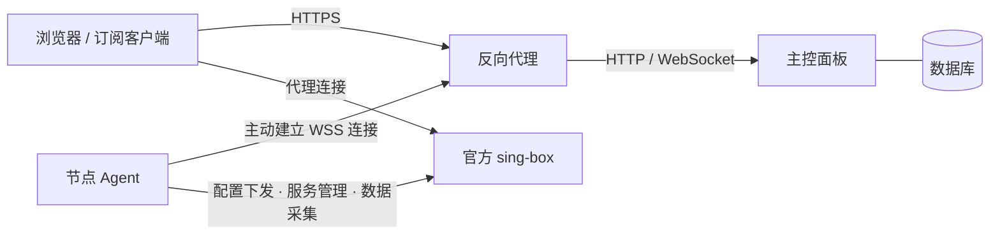

<h1 align="center">
  <picture>
    <source media="(prefers-color-scheme: dark)" srcset="docs/assets/readme-header-dark.svg">
    
  </picture>
</h1>

<p align="center">面向官方 sing-box 的多节点管理面板，统一管理配置、用户、订阅与流量。</p>

## 安装

### Binary

支持 Linux amd64 / arm64，主控需要 systemd。准备域名及支持 WebSocket 的 HTTPS 反向代理，然后执行：

```bash
curl -fsSL https://github.com/hann0w0/SingBox-Panel/releases/latest/download/install.sh | sudo bash
```

按提示完成配置，默认监听 `127.0.0.1:32334`，数据保存在 `/opt/singbox-panel`。

### Docker

替换域名、管理员账号和初始密码后执行：

```bash
docker run -d \
  --name singbox-panel \
  --restart unless-stopped \
  --stop-timeout 30 \
  -p 127.0.0.1:32334:8080 \
  -v singbox-panel-data:/app/data \
  -e SINGBOX_PANEL_BASE_URL='https://panel.example.com' \
  -e SINGBOX_PANEL_ADMIN_EMAIL='admin' \
  -e SINGBOX_PANEL_ADMIN_PASSWORD='请替换为自己的初始密码' \
  ghcr.io/hann0w0/singbox-panel:latest
```

镜像支持 amd64 / arm64。通过 HTTPS 反向代理访问，需支持 WebSocket 并覆盖 `X-Real-IP`。Compose、反向代理与更新步骤见 [Docker 部署说明](docs/docker.md)。

两种方式安装后，均在面板创建服务器，复制节点详情页生成的 Agent 安装命令，到目标 VPS 执行。节点支持 systemd 和 Alpine OpenRC。

## 卸载

### Binary 主控

```bash
# 卸载服务，保留配置与数据库
curl -fsSL https://github.com/hann0w0/SingBox-Panel/releases/latest/download/install.sh | sudo bash -s -- --uninstall --yes

# 完整卸载，删除配置与数据库
curl -fsSL https://github.com/hann0w0/SingBox-Panel/releases/latest/download/install.sh | sudo bash -s -- --uninstall --purge --yes
```

### Docker 主控

```bash
# docker run 部署
docker stop singbox-panel && docker rm singbox-panel

# Docker Compose 部署：在配置目录执行
docker compose down
```

默认保留数据卷；`docker compose down -v` 或删除数据卷会清空面板数据。卸载主控不会卸载节点上的 Agent 和 sing-box。

### 节点 Agent

可在面板服务器详情页卸载，也可在目标节点执行以下命令。仅删除 Agent 及其配置，保留 sing-box。

**systemd：**

```bash
sudo systemctl disable --now singbox-panel-agent.service && \
sudo rm -f /etc/systemd/system/singbox-panel-agent.service /usr/local/bin/singbox-panel-agent && \
sudo rm -rf /etc/singbox-panel-agent && \
sudo systemctl daemon-reload
```

**Alpine / OpenRC（以 root 执行）：**

```sh
rc-service singbox-panel-agent stop && \
rc-update del singbox-panel-agent default && \
rm -f /etc/init.d/singbox-panel-agent /run/singbox-panel-agent.pid /usr/local/bin/singbox-panel-agent && \
rm -rf /etc/singbox-panel-agent
```

如需同时卸载 sing-box，请先在面板执行「卸载 sing-box」，再卸载 Agent。

## 工作模式



主控支持 Binary 或 Docker 部署；Agent 与 sing-box 在节点宿主机运行。Agent 主动连接主控，节点无需额外开放管理端口，代理流量由节点上的 sing-box 直接处理。

## 开源许可

本项目采用 [MIT License](LICENSE) 开源。
