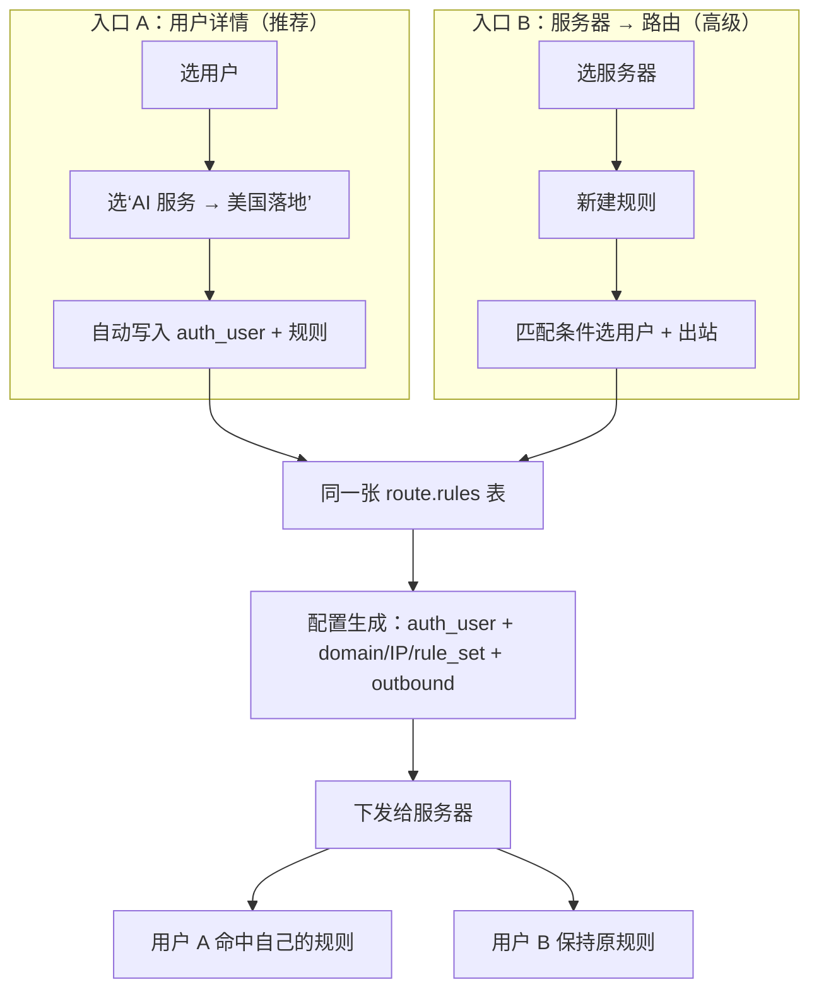
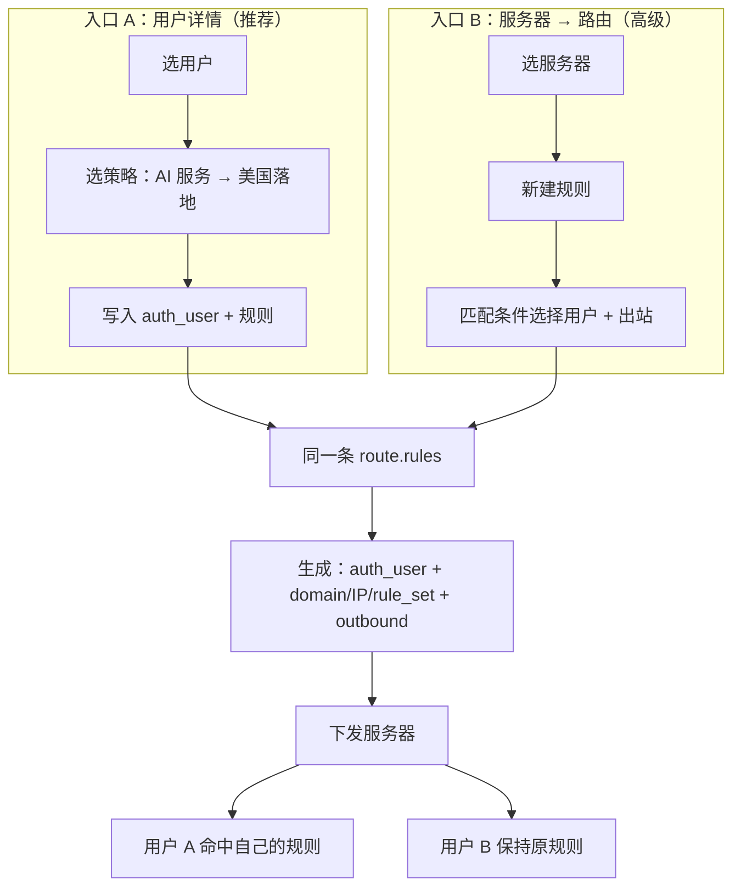

# 按用户分流方案

## 核心结论

sing-box 的 `route.rules[].auth_user` 匹配的是多用户入站的 `users[].name`，不是 UUID。
本面板为每个用户/入站生成稳定唯一的 `name`，所以可以只在服务器侧增加按用户的规则；客户端节点、UUID、密码不变，也不影响其他用户。

## 全链路



## 规则形态

```json
{
  "route": {
    "rules": [
      {
        "auth_user": ["__singbox_panel_user__:12:7f3a9c"],
        "domain_suffix": ["openai.com"],
        "outbound": "us-landing"
      }
    ],
    "final": "direct"
  }
}
```

## 产品上的两种入口

1. **用户维度（推荐）**
   用户详情 → 分流策略 → 选择“AI 服务 → 美国落地”。
   面板自动把 `auth_user` 和规则一起写到对应服务器。

2. **服务器维度（高级）**
   服务器 → 路由 → 新建规则 → 选择“用户”作为匹配条件之一。
   适合管理员集中维护多条规则；用户维度只是同一份数据的快捷入口。

## 关键边界

- `auth_user` 只负责“是谁”；域名、IP、端口、规则集仍按普通 route rule 组合。
- 只对多用户入站生效（如 VLESS、VMess、Trojan、Hysteria2、TUIC、AnyTLS、SS2022 AES、Snell，具体以节点 sing-box 版本为准）。
- 单用户入站没有 `users[].name`，无法按用户区分；同一入站的所有人共享凭据。
- 规则只下发到服务器，不进入用户订阅；不改其他用户节点、UUID 或密码。
- 用户被撤销/删除、出站被删除、规则集失效，都必须有状态提示和清理，不能静默留下不可达规则。
- 一个用户可以匹配多条规则，按明确优先级求并集；同一请求命中多条时不能依赖数据库顺序。
- 用户身份名必须稳定且不可猜；不要直接把可枚举的 email 作为 `auth_user`。

## 落地优先级

1. 先做后台的 `UserRoutePolicy`（用户 + 服务器 + 规则）与 `auth_user` 生成。
2. 复用现有出站、规则集、路由编辑器，不新增第二套规则 DSL。
3. 配置生成时做引用校验和冲突检查。
4. 用户详情显示策略状态；订阅端不变。
5. 最后再加用户组和批量授权。

## 两种入口与同一条路由链


