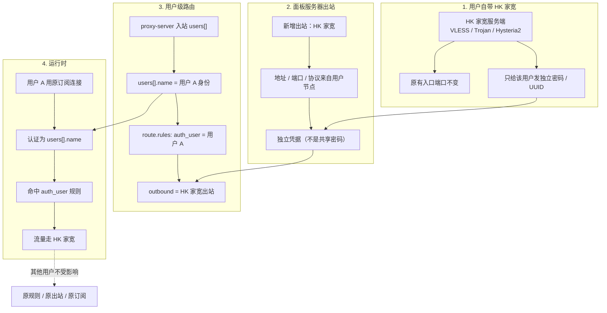

# 用户自带 HK 家宽出站方案

## 场景

用户 A 在 HK 家宽上运行一个服务端（例如 VLESS / Trojan / Hysteria2），希望：
- 继续使用原来的入口端口，不改客户端订阅；
- 只有用户 A 的流量能走到这个 HK 家宽出站；
- 换密码不换端口，避免影响其他人的节点；
- 不影响服务器上其他用户或其他规则。

## 关键结论

这不是“用户自带节点直接加入订阅”那么简单。正确做法是：
**服务器侧增加一个“用户专属出站”，用独立用户身份认证 HK 家宽服务端，再由 `auth_user` 规则只让该用户命中。**

## 全链路



## 配置形态

### 入口服务器：用户多用户入站

```json
{
  "inbounds": [
    {
      "type": "vless",
      "tag": "entry-vless",
      "listen_port": 443,
      "users": [
        { "name": "__singbox_panel_user__:A:7f3a", "uuid": "aaaa-..." },
        { "name": "__singbox_panel_user__:B:19c2", "uuid": "bbbb-..." }
      ]
    }
  ]
}
```

### 入口服务器：用户专属出站

```json
{
  "outbounds": [
    {
      "type": "vless",
      "tag": "user-a-hk-home",
      "server": "hk-home.example.net",
      "server_port": 443,
      "uuid": "user-a-only-uuid",
      "tls": { "enabled": true, "server_name": "hk-home.example.net" }
    }
  ]
}
```

### 入口服务器：只匹配用户 A 的规则

```json
{
  "route": {
    "rules": [
      {
        "auth_user": ["__singbox_panel_user__:A:7f3a"],
        "outbound": "user-a-hk-home"
      }
    ],
    "final": "direct"
  }
}
```

## 端口与密码

- **入口端口**：不变。用户 A 仍连接原入口服务器的原端口。
- **HK 家宽端口**：不变。出站仍连接用户原来的 HK 家宽端口。
- **凭据**：可以只换密码 / UUID。该凭据只属于这个出站，不进入其他用户的订阅。
- **不共享**：不要把 HK 家宽的用户密码写成入口服务器的共享密码，否则同一入口的其他用户也能使用它。

## 产品实现边界

1. 用户自带节点应作为“私有用出站”导入，而不是直接变成公共订阅节点。
2. 出站需要独立凭据字段；当前 `Outbound` 已能保存私有凭据，但还不能区分“用户专属”与“服务器公共”。
3. 可先给 `Outbound` 增加 `owner_user_id`（0 = 公共出站，非 0 = 私有用出站），最小改动且能复用现有导入、校验、配置下发。
4. `auth_user` 规则由“私有出站 + 用户 + 入口服务器”自动生成；不要手工填写 UUID。
5. 用户删除或出站撤销时，清除 `auth_user` 规则，并让入口服务器重新下发。
6. 失败可见：HK 家宽不可达时只影响用户 A 的规则，不能让整个服务器配置校验失败。
7. 如果入口入站是单用户模式，没有 `users[].name`，此方案不可用；需要先改成多用户入站。

## 最小落地路径

1. 先支持“用户私有出站”（`owner_user_id` + 凭据）；公共出站保持 `owner_user_id = 0`。
2. 复用现有出站导入，填地址 / 端口 / 协议 / 凭据。
3. 自动生成 `auth_user` 规则，绑定入口服务器。
4. 用户详情页只显示“我的专属出站”状态，不展示其他用户凭据。
5. 再加用户组和模板，避免每个用户都手工配置。
